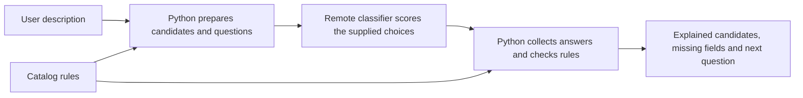

This directory contains Python experiments for turning a product description into explained КТРУ candidates. Start with the idea, then use the commands below. The scripts run on your laptop and call the team's existing classifier model on the server. You do not need to load model weights or use a notebook.

The two entry points are [classifier_experiments.py](classifier_experiments.py), which tests individual parts of the idea, and [classifier_pipeline.py](classifier_pipeline.py), which connects those parts. [results-analysis.md](results-analysis.md) reviews the saved model runs. [pipeline-explanation.md](pipeline-explanation.md) explains implementation choices in more detail. The original proposal is in [data/notes.md](../data/notes.md).

The same connected pipeline is available through the [FastAPI backend](../backend/README.md). On first setup, copy [.example.env](../.example.env) to `.env` and configure your service addresses. Both entry points automatically load the repository-root `.env` with `python-dotenv`; exported variables win, and command-line flags override the configured defaults. The template contains localhost addresses, model IDs, timeouts, paths, embedding prefixes, batch size and pipeline defaults. The actual `.env` is ignored by Git. Run `uv run --locked -m backend.src` from the repository root, then open `http://127.0.0.1:8000/docs`. `/preview` searches using the configured embedder and prepares a plan without calling the classifier; `/analyze` uses the configured classifier service and returns the complete explanation report.

**1. Start with the problem.**

Suppose the user writes:

> Нужна аккумуляторная дрель 18 В с реверсом, без ударного режима.

We want to understand the product, find plausible КТРУ positions, and explain which requirements fit. A useful interpretation would be:

| Property | What the description says |
|---|---|
| Product | Drill |
| Power supply | Battery |
| Battery voltage | 18 V |
| Reverse | Yes |
| Impact mode | No |
| Battery capacity | Not stated |
| Number of batteries included | Not stated |
| Chuck diameters | Not stated |

The last three rows matter. A system that fills them with guesses can produce a convincing but incorrect specification. “Not stated” must remain visible.

The desired output is a structured account of known properties, possible catalog positions, contradictions, missing information and the next useful question. The current pipeline is an experiment toward that output. It deliberately does not issue a final validated code.

**2. Understand the catalog before involving a model.**

For these experiments, a КТРУ position is a catalog record with a code, version, product name and characteristic definitions. A characteristic definition may contain allowed values, numeric limits, a unit and a required flag.

Three ideas need to stay separate:

| Term | Example | Meaning here |
|---|---|---|
| Characteristic | Тип питания | A property we can describe |
| Product fact | Тип питания = От аккумулятора | A claim about the user's particular product |
| Catalog rule | This position permits battery power | A condition against which we check that claim |

A catalog listing both “Да” and “Нет” for reverse does not say the product has both. It permits a choice. The user's description supplies the actual choice.

A **candidate** is simply a position still worth checking. Keeping a candidate means that the checks performed so far have not ruled it out. It does not mean that all required information is present.

The supplied electric-drill family contains these two positions:

| Code and version | Name | Power supply |
|---|---|---|
| `28.24.11.000-00000001@5` | Дрель ручная электрическая | От сети |
| `28.24.11.000-00000002@4` | Дрель ручная электрическая | От аккумулятора |

Battery power distinguishes them. Reverse and impact do not distinguish this pair because both positions permit yes/no values for those properties.

The `@4` suffix means version 4. Code and version together identify the record whose rules we checked. Positions with the same displayed name remain separate records.

**3. Where the experiment's catalog comes from.**

The importer reads the supplied XML files whose names contain `all_actual`. It selects records marked ACTIVE and non-template, then keeps these exploratory subsets:

| Scope | How it is selected |
|---|---|
| `clothing` | Rubric code 116 |
| `furniture` | Rubric code 128 |
| `tools` | Code prefixes 25.73 and 28.24 |
| `drills` | Exact position name Дрель ручная электрическая |
| `all` | The union of the three selected domains |

The current snapshot has 82 XML parts, 1,302 selected positions and 2,568 distinct categorical facts. “All” means all of this selected snapshot, not every КТРУ product or every item in the Excel workbooks.

The importer retains characteristic rules and their source locations. It also preserves dates, but this experiment does not implement a complete date/eligibility policy. ACTIVE and an “actual” filename alone do not complete that review.

A fact appearing in several positions is stored once with references back to each source. The deduplication key uses normalized characteristic name, value and unit code. Normalization here means lowercase, whitespace cleanup and ё → е. It does not prove that similarly named properties in different product contexts mean the same thing.

The suite runner saves the prepared catalog to `results/catalog.json` and reuses it. After changing source data, rebuild it with:

```bash
uv run --locked python experiments/classifier_experiments.py \
  --suite facts --rebuild-catalog --dry-run
```

The pipeline uses that cache if present. Without it, it imports the catalog for the current invocation. It does not write a new cache itself.

**4. What Python does and what the classifier does.**

Python reads the catalog, finds possible positions, constructs questions, parses numbers, converts units, checks numeric limits and writes the results.

The classifier judges the meaning of the description against choices Python supplies. For example: “Does this description support battery power?” or “Which of these numbers belongs to the battery?”



The current model API is a choice-scoring service. These scripts do not ask it to write an unrestricted JSON specification. Python creates JSON from the answers it receives.

The notes suggest an action space, where a model could choose actions repeatedly. A choice can name an action, but application code would still have to execute that action, keep state and prepare the next choices. The current client does not implement that loop or arbitrary tool arguments. Catalog facts and input number spans already provide choices for this experiment.

The current deployment reports `jiwo-4b` through `/health`. `CLASSIFIER_MODEL` in `.env` controls the expected model ID and the model field of inference requests. Earlier saved experiments used `bespokelabs/Bespoke-Nimble-9B-v3`; their recorded model IDs and results remain historical evidence. Your laptop sends text requests; the server performs model inference.

**5. How a categorical fact is checked.**

For every candidate fact, Python supplies four possible answers:

| Answer | Plain meaning | Example for the fact “battery powered” |
|---|---|---|
| `supported` | The description says this is true | Аккумуляторная дрель |
| `contradicted` | The description explicitly rules this out | Дрель только от сети, аккумулятора нет |
| `unknown` | The description does not settle it | Нужна дрель с реверсом |
| `conflicting` | Unresolved statements support and deny it | Two incompatible power requirements both remain in force |

An explicit correction is different from an unresolved conflict. If the user cancels the earlier mains requirement and replaces it with battery power, the intended current value is battery power. The follow-up suite tests this distinction.

The value being checked can itself be “Нет.” If the description says “без ударного режима,” the fact “impact mode = No” should be supported. Supported does not mean that every property has the value Yes.

The API request has three main fields:

- `model`: the model we expect the server to use.
- `state`: the user's description.
- `questions`: named questions, each containing a type, instructions and answer criteria.

Here is an illustrative valid choice request. The criterion wording is shortened for teaching; exact experiment questions are saved in `requests.jsonl`.

```json
{
  "model": "jiwo-4b",
  "state": "Нужна аккумуляторная дрель.",
  "questions": {
    "power": {
      "type": "choice",
      "instructions": "Проверь факт: тип питания товара — от аккумулятора.",
      "criteria": {
        "supported": "Описание подтверждает факт.",
        "contradicted": "Описание отрицает факт.",
        "unknown": "Недостаточно данных.",
        "conflicting": "Одновременно есть подтверждение и отрицание."
      }
    }
  }
}
```

The server returns a selected choice and a probability for each supplied choice. For example, these invented numbers illustrate the format; they are not an experiment result:

```json
{
  "model": "jiwo-4b",
  "answers": {
    "power": {
      "type": "choice",
      "choice": "supported",
      "confidence": 0.90,
      "probabilities": {
        "supported": 0.90,
        "contradicted": 0.03,
        "unknown": 0.05,
        "conflicting": 0.02
      }
    }
  }
}
```

These probabilities sum to one for this question. Probabilities from twenty different fact questions do not form one distribution; several facts can all be supported.

The client verifies the model name, question IDs, available choices and probability distribution. That catches malformed responses. It cannot establish whether the answer is true.

The supplied service uses `GET /health` and `POST /v1/systemone`. It is not an OpenAI chat-completions API or the alternative OpenJev `/score` service described in the notes. The handler supports choice and noul questions; these experiments use choice.

**6. Why a probability is not a guarantee.**

The reported scores compare the supplied answers for the supplied wording. A score of 0.9 does not establish that nine out of ten similar claims will be correct. Establishing that relationship requires a separate calibration evaluation with reviewed examples.

The experiment's default threshold is 0.8. A supported categorical fact affects narrowing only when its supported probability reaches that threshold. The original answer is still saved even if it is withheld from narrowing.

The current results show why this distinction matters:

| Description and fact | Model's supported score | Effect at threshold 0.8 |
|---|---:|---|
| Нужна дрель. → impact mode = Yes | 0.848 | An invented fact passes |
| Нужна аккумуляторная дрель с реверсом, без ударного режима. → impact mode = No | 0.690 | A correct fact is withheld |

The second fact scores about 0.922 in a different default description containing “18 В,” and about 0.974 in another closely related wording. Changing the wording changes the scores.

A higher threshold trades fewer accepted facts for more omissions. The threshold alone cannot provide reliable extraction. We need evidence checking and evaluation on descriptions that were not used to choose the threshold.

**7. How numbers are handled.**

A number needs both a value and an owner. Consider:

> Аккумуляторная дрель 18 В, зарядное устройство от сети 220 В.

Python finds two **spans**, meaning exact pieces of the original text with start/end character offsets:

| Raw span | Normalized value | Possible owner |
|---|---:|---|
| 18 В | 18 V | Drill battery |
| 220 В | 220 V | Charger input |

Matching units is not enough to decide ownership. Both numbers are voltages. The classifier chooses the span that describes the requested property, or returns unknown/conflicting. Python then uses the selected normalized value.

For `0,018 кВ`, Python replaces the decimal comma for parsing and multiplies by 1,000: the normalized value is `18.000` V, numerically equal to 18 V. The current numeric suite still fails to select that span, even though Python's conversion succeeds.

The parser supports a limited set of written units: В/кВ, Вт/кВт, мм/см/м and А·ч variants. It normalizes to volts, watts, millimeters or ampere-hours and records the corresponding OKEI code. OKEI is the unit identifier used in the catalog; for example, 222 identifies volts. Unsupported units and free-text numeric formats need additional work.

The standalone numeric suite tests battery-voltage ownership. It does not compare the selected voltage with catalog ranges. The pipeline extends ownership questions to numerical properties of the retrieved positions, then applies their rules.

For an illustrative catalog interval `12 ≤ voltage < 20`:

| Input value | Python's check |
|---|---|
| 12 V | Inside: lower boundary is included |
| 18 V | Inside |
| 20 V | Outside: upper boundary is excluded |

The illustration teaches the boundary check; it is not the battery drill's complete voltage rule. Catalog alternatives may contain several intervals or exact values. Matching one known permitted alternative is enough for the numerical rule check. If rule information is missing or unsupported, the check remains uncertain.

The pipeline does not treat signed values, bounds or detected range endpoints as exact point values. For example, “не менее 18 В” needs a range interpretation rather than silently becoming “exactly 18 V.” Such measurements remain available for review. This is a limited parser, not a complete interpreter for every numeric expression.

**8. What the connected pipeline does, step by step.**

Run [classifier_pipeline.py](classifier_pipeline.py) when you want to follow one description through the combined process.

The backend and pipeline CLI default to embedding retrieval through the meow-embed service configured in `.env`. The example configuration uses `google/embeddinggemma-2`. The 283 distinct normalized names in the 1,302-position snapshot are embedded in batches and cached; the full description is embedded with the query prompt. Cosine similarity selects up to four nearest names within the scope, and their code/version alternatives are interleaved up to `top_k` (eight in the example configuration). No shared words or similarity acceptance threshold are required. `retrieval.truncated=true` means catalog positions were left outside the shortlist; it does not establish recall.

The original word-based search remains available only as the explicit CLI baseline `--retrieval lexical` and for historical offline experiment preparation. It uses a leading product phrase, simple suffix stripping and shared-word ranking. Use this mode when replaying older lexical runs. Embedding retrieval requires the service even for `--dry-run` and `--replay`; a dry run can build the vector cache but does not call the classifier.

CLI embedding settings are `--embedding-base-url`, `--embedding-model`, `--embedding-cache`, `--embedding-timeout`, `--embedding-batch-size` and `--embedding-max-names`. The service/model defaults match the backend. Standalone experiments continue to export files; the backend stores its catalog, vectors, runs and request logs in PostgreSQL with pgvector. The backend's environment settings and persistence are documented in [backend/README.md](../backend/README.md).

Next it asks the classifier whether each distinct candidate name describes the actual product. For example, mechanical and electric drills can both match the word “дрель,” but battery-powered text should help distinguish them. A candidate name clearly contradicted above the threshold is excluded; an unsupported/uncertain name cannot produce a provisional selection.

Then it collects the categorical facts associated with those candidates and scores them independently. It also parses numerical spans and asks ownership questions for candidate numerical properties with supported matching units.

Python applies the accepted evidence to each position:

- A supported categorical value matches a position that permits that value.
- An incompatible supported value can exclude a position.
- A property absent from a position's schema is recorded as an extra rather than automatically treated as a contradiction.
- Two incompatible accepted values for a property that permits only one are treated as uncertain.
- A numerical value outside every known permitted alternative excludes the candidate; uncertain rules remain uncertain.
- Required properties without an established matching value are listed as missing.

A contradicted hypothesis does not automatically remove a position. If a position permits both reverse=yes and reverse=no, rejecting reverse=no leaves reverse=yes available. Catalog alternatives are permissions, not assertions about the particular product.

Finally, the pipeline classifies candidates as `supported`, `uncertain` or `rejected`. Missing inference answers are handled first; no remaining candidate prompts a contradiction/search review; conflicts prompt correction. If supported candidates exist, clarification focuses on those candidates: first an unanswered categorical property that distinguishes them, then a required missing property. An uncertain product alternative remains visible but does not make the user repeat an already supported product type. If no product identity is supported, the pipeline asks for the product type.

The script returns the question as text. It does not run an interactive conversation or maintain a chat session. A user can edit the description and rerun it; the evidence and shortlist are recomputed.

**9. Why a single remaining code is still not a final answer.**

The saved drill experiments narrow two electric-drill positions to the battery position. They check categorical facts inside an already chosen family. They do not establish product retrieval quality or complete the numerical specification.

The battery position requires these characteristics:

| Required field | What the example supplies |
|---|---|
| Power supply | Battery power is stated |
| Minimum chuck diameter | Missing |
| Maximum chuck diameter | Missing |
| Maximum RPM | Missing |
| Battery capacity | Missing |
| Battery voltage | 18 V is stated; ownership/rule validation is a separate check |

This is enough to understand why missing required fields do not eliminate a candidate: the description can be incomplete while the position remains plausible. Instead, those fields provide clarification questions.

The pipeline always returns `final_code: null`. Lifecycle/date eligibility, verified categorical source spans and all remaining application rules still need validation.

It may return `provisional_candidate` when inference is complete, exactly one candidate has assessment `supported`, and relevant conflict/uncertainty checks permit it. Uncertain alternatives remain visible for review rather than being silently excluded. That provisional field can coexist with missing required fields. It means “one positively supported candidate in this checked shortlist,” not “all specification requirements are satisfied.” If its required fields are covered, the status becomes `ready_for_review`; this still does not issue a final code.

**10. What happens to extra information.**

There are two different cases.

An **unbound measurement** is a number found in the raw description whose property/owner was not established. It might belong to packaging, a charger or the product. It stays in `unbound_measurements` with its original text and offsets.

A **user-supplied extra** is an explicit field added through a command such as:

```bash
uv run --locked python experiments/classifier_pipeline.py \
  --text 'Нужна аккумуляторная дрель 18 В.' \
  --extra 'Цвет=Синий' --dry-run
```

Its treatment depends on the candidate:

| Output action | Meaning |
|---|---|
| `do_not_add` | The candidate has `noNewFeatures=true`; keep the information for review but do not add it as an extra characteristic |
| `review_before_add` | The flag is false; review the field before adding it |
| `additional_field_policy_unknown` | The candidate's flag does not settle the policy |
| `map_and_validate` | A characteristic with that name already exists; map and validate the supplied value |

The script preserves these actions; it does not rewrite the input, automatically drop fields, or complete an SPGZ mapping. It also does not extract every arbitrary free-text property. Categorical facts come from candidate catalog vocabulary; numerical values come from supported input spans; `--extra` preserves explicit user fields.

**11. What each experiment is trying to answer.**

A **suite** is a predefined collection of experiment questions. A **label** is the expected answer we assigned before comparing the model's answer with it.

| Suite | Question it investigates | Default questions / HTTP requests |
|---|---|---:|
| `smoke` | Can the model handle basic explicit facts, negation, missing information, conflict, a typo, packaging and broad domains? | 16 / 16 |
| `numeric` | Can it choose battery-voltage spans and reject charger voltage? | 6 / 6 |
| `followup` | Does showing normalized numbers help, and how do clearer missing/conflicting/corrected examples behave? | 29 / 29 |
| `slots` | Can it choose one allowed value for each categorical property, including unknown/conflicting? | 9 / 9 |
| `facts` | Can it check every categorical fact in the chosen family independently? | 20 / 5 for drills |
| `progressive` | What changes when the same drill family sees increasingly specific input? | 80 / 20 |
| `order` | Does changing answer order or repeating a request change the result? | 3 / 3 |

Slots ask, for example: “Which power supply is stated: battery, mains, unknown or conflicting?” Independent facts ask separately whether battery power and mains power are supported. Several independent properties can be supported together. A multivalued property also cannot always be represented by selecting a single slot value.

The progressive suite uses these four descriptions:

1. Нужна дрель.
2. Нужна аккумуляторная дрель.
3. Нужна аккумуляторная дрель с реверсом.
4. Нужна аккумуляторная дрель с реверсом, без ударного режима.

Each description gets a fresh twenty-fact scan. The suite does not reuse scores from the previous description. It lets us see whether new wording changes unrelated answers or introduces unsupported facts.

The follow-up contains six numeric cases scored twice, giving twelve questions. One arm presents the raw span, such as `0,018 кВ`. The other presents the same span plus Python's normalized value, 18 V. Input text, question instructions, available answer IDs and expected labels stay the same; only the voltage candidate descriptions change.

The other seventeen follow-up questions cover tools, furniture and clothing, with explicit values, missing information, negation, packaging, unresolved contradictions and explicit corrections. Its fact labels comprise four supported, six contradicted, five unknown and two conflicting cases.

The exact-value **baseline** is a simple comparison method: look for the catalog value literally in the text. It has no synonym or negation understanding and abstains on yes/no values. Comparing it with the model on the same labeled cases helps establish what the model adds. It is deliberately basic.

The `--text` option changes the input for facts and slots. Smoke, numeric, follow-up and order use fixed predefined descriptions; progressive uses its fixed four steps. `--scope` affects facts/slots; progressive always uses drills. This prevents interpreting a command-line option as changing a test that ignores it.

**12. Questions, requests and runtime are different things.**

A **question** is one decision, such as the status of battery power.

An **HTTP request** is one message to the server. It can carry several questions. With twenty facts and `--chunk-size 4`, Python sends five requests containing four questions each.

The supplied handler evaluates questions sequentially with a model evaluation for each. Combining them into one HTTP request does not make them a single shared computation or parallel GPU batch. It can affect request/prompt overhead and wording context, so it is still useful to compare chunk sizes.

The latest complete family fact runs take about 10.3 seconds for twenty questions. A four-fact HTTP request has a median around 2.1 seconds. The complete progressive suite takes about 40.8 seconds because it evaluates four inputs.

Extrapolating that rate to 2,568 facts suggests roughly 22 minutes per description. That is an estimate; no full scan was measured. The pipeline's shortlist exists to reduce this work.

The default pipeline also refuses plans exceeding `--max-questions 128`. This counts model questions, not text tokens. The server separately enforces its reported 6,144-token prompt budget. Tokens are pieces of text used by the model; a question-count limit cannot guarantee a prompt fits.

To compare chunking with ordinary Python scripts, keep text/scope fixed and run the facts suite with `--chunk-size 1`, then 4, then 8. Compare saved answer distributions, server-reported input-token usage and summed request times. Do not infer GPU speed solely from a single request time on a shared server.

**13. Three kinds of “test” establish different things.**

| What you run | Contacts the classifier? | What it establishes |
|---|---|---|
| Offline unit tests | No; API behavior is simulated where needed | Python control flow, conversions, boundaries, unknown/conflict handling and saved-file behavior |
| `--dry-run` | No; the embedding pipeline still contacts meow-embed | Which requests would be sent and whether preparation succeeds |
| A live suite/pipeline command | Yes, when it has planned questions | What the deployed model actually returns on those inputs |

A passing unit test cannot prove the classifier understands a description. A successful dry run cannot prove extraction accuracy. A successful `/health` response confirms server/configuration reachability, but a model-scoring request must still succeed.

The labeled examples are manually written development cases. Real STE descriptions from the source audit lack verified КТРУ labels. They are useful for inspection but do not yet form a final-code benchmark.

**14. Run the local checks and previews first.**

Run commands from the repository root. `uv run --locked` uses the project's dependency environment without changing the lockfile. The experiment scripts themselves use the Python standard library.

Check the Python implementation:

```bash
uv run --locked python -m unittest discover -s experiments -p 'test_*.py' -v
```

Prepare suite requests without model calls:

```bash
uv run --locked python experiments/classifier_experiments.py --suite smoke --dry-run
uv run --locked python experiments/classifier_experiments.py --suite facts --dry-run
uv run --locked python experiments/classifier_experiments.py --suite followup --dry-run
```

Prepare a connected pipeline request plan:

```bash
uv run --locked python experiments/classifier_pipeline.py \
  --text 'Нужна аккумуляторная дрель 18 В с реверсом, без ударного режима.' \
  --dry-run
```

The pipeline defaults to scope `all`. Use `--scope drills` to isolate the two-position electric-drill pilot. With the current snapshot, the default example prepares 25 questions in nine requests and retrieves four positions: mechanical and electric drills. This is request preparation, not measured relevance/extraction.

A dry run prints its plan to the terminal. It does not create a live inference run or `followup_report.json`. Suite catalog preparation can still create/update the local cache.

**15. Connect the laptop to the existing model server.**

The team's server listens on its own loopback address, port 8769. Your laptop's `127.0.0.1` refers to your laptop, not that server. An SSH tunnel connects the two.

Set `CLASSIFIER_BASE_URL` in `.env` to the service address, including its reverse-proxy path when applicable. For an HTTPS deployment, check its `/health` endpoint directly. The localhost address in `.example.env` is intended for a local service or tunnel.

For a deployment that is available only on the compute server's loopback address, start this optional tunnel in one terminal and keep it running. Select it with `--base-url http://127.0.0.1:8769` or `CLASSIFIER_BASE_URL=http://127.0.0.1:8769` for the backend:

```bash
ssh -N -o ExitOnForwardFailure=yes \
  -L 127.0.0.1:8769:127.0.0.1:8769 inh-compute
```

The first address/port is the listener on your laptop. The second is the destination as reached from `inh-compute`. `-N` starts forwarding without a remote shell command. This command does not start the model service; that service must already be running on the server.

If SSH reports the previously observed system configuration permissions error, explicitly select your user configuration by adding `-F ~/.ssh/config`.

If local port 8769 is already occupied, use `-L 127.0.0.1:8770:127.0.0.1:8769` and pass `--base-url http://127.0.0.1:8770` to the scripts. The remote port remains 8769.

In another terminal, check reachability:

```bash
curl --fail-with-body http://127.0.0.1:8769/health
```

Closing the laptop tunnel closes forwarding; it does not stop the remote model. Reconnect the tunnel after a network/VPN interruption.

**16. Run real model experiments.**

These commands intentionally omit `--dry-run`:

```bash
uv run --locked python experiments/classifier_experiments.py --suite smoke
uv run --locked python experiments/classifier_experiments.py --suite numeric
uv run --locked python experiments/classifier_experiments.py --suite followup
uv run --locked python experiments/classifier_experiments.py --suite slots
uv run --locked python experiments/classifier_experiments.py --suite facts
uv run --locked python experiments/classifier_experiments.py --suite progressive
uv run --locked python experiments/classifier_experiments.py --suite order
```

Each command creates its own result directory. Run them sequentially against the shared service. The follow-up command must omit `--dry-run` if you want actual normalized-number results.

To run the combined pipeline:

```bash
uv run --locked python experiments/classifier_pipeline.py \
  --text 'Нужна аккумуляторная дрель 18 В с реверсом, без ударного режима.'
```

To change a fact-scan input:

```bash
uv run --locked python experiments/classifier_experiments.py --suite facts \
  --text 'Аккумуляторная дрель с реверсом, без ударного режима.'
```

To inspect a different vocabulary before submitting it:

```bash
uv run --locked python experiments/classifier_experiments.py --suite facts \
  --scope furniture --text 'Нужен стул без подлокотников.' --dry-run

uv run --locked python experiments/classifier_experiments.py --suite facts \
  --scope all --dry-run
```

The all-scope fact scan prepares 642 requests for 2,568 questions at the default chunk size. Removing `--dry-run` executes that large plan. It remains a categorical-vocabulary scan, not complete numerical/free-text extraction.

Useful options:

| Option | What changes |
|---|---|
| `--scope` | Catalog subset; defaults to drills for facts/slots and all for the pipeline |
| `--chunk-size` | Fact questions per HTTP request; default 4 |
| `--threshold` | Experimental supported/binding acceptance cutoff; default 0.8 |
| `--base-url` | classifier service address; default from `CLASSIFIER_BASE_URL` |
| `--timeout` | Maximum wait per HTTP call; default 180 seconds |
| `--catalog-cache` | Prepared catalog file to load |
| `--output` | New result directory to create |
| `--top-k` | Pipeline's maximum retrieved positions; default 8 |
| `--max-questions` | Pipeline's question budget; default 128 |
| `--retrieval` | Pipeline retrieval mode; `embedding` by default, `lexical` for historical offline runs |
| `--embedding-base-url` | meow-embed address; default from `EMBEDDING_BASE_URL` |
| `--embedding-model` | Dense embedding model; default google/embeddinggemma-2 |
| `--embedding-cache` | Persistent catalog vectors; default backend/cache/catalog_embeddings.json |
| `--embedding-timeout` | Maximum wait per embedding request; default 60 seconds |
| `--embedding-batch-size` | Catalog names per embedding request; default 32 |
| `--extra NAME=VALUE` | Pipeline's explicit user property to preserve/review |
| `--replay` | Pipeline's saved-run input instead of fresh classifier calls; use `--retrieval lexical` for older lexical runs |

Output directories must be new. Existing results are not overwritten.

**17. Read the files as an account of what happened.**

Live runs normally create `experiments/results/<UTC timestamp>_<suite>/`. The timestamp is UTC, so it may differ from your local clock.

| File | What it tells you |
|---|---|
| `health.json` | Model/configuration reported before scoring |
| `manifest.json` | Endpoint, timeout, scope, threshold, planned requests and catalog hash when used |
| `requests.jsonl` | Each saved request, answer, timing, metadata and expected labels when present |
| `model_requests.jsonl` | Complete outgoing inference payloads, timestamps and URLs, flushed before dispatch |
| `summary.json` | Counts, label accuracy, confusion, latency and suite-specific checks |
| `startup_error.json` | Health/model validation failed before scoring; normal run files may be absent |
| `followup_report.json` | Follow-up numeric A/B pairs, per-domain results and supported-fact metrics |
| `analysis.json` | Pipeline's candidates, missing fields, measurements, extras, explanations and next question |
| `request_plan.json` | Pipeline questions prepared for the input |

JSONL means one JSON object per line. The runner flushes each record to disk, which lets a partial log retain useful completed answers even when the command does not finish.

Console logging at `LOG_LEVEL=info` shows request progress, IDs, experiment and question count. Use `LOG_LEVEL=debug` for full outgoing JSON. File evidence remains complete at both levels.

Start with the summary or pipeline analysis. Open the raw record whenever you need to understand a surprising result: inspect the original description, exact question, selected answer, all scores and expected label. A summary cannot show every detail.

Health's base-model revision and the catalog's SHA-256 hash help compare runs. A hash is a fingerprint of the prepared catalog content: different content produces a different fingerprint. The service does not expose a complete adapter revision, so these files alone do not fully identify every model artifact.

The reported allocated memory is a health snapshot, not peak inference memory. HTTP wall time includes the service's workload and communication; it is not an isolated GPU benchmark.

**18. Read the metrics without mistaking them for a final-code score.**

**Status accuracy** is correct labeled answers divided by recorded labeled questions. An answer is correct when it matches the saved expected label. In slots/facts/progressive runs without saved labels, accuracy is `null`; zero saved labels means unmeasured accuracy, not zero model quality.

A **confusion row** says how an expected answer was classified. Expected conflicting → predicted contradicted identifies that particular kind of mistake.

**Supported-fact precision** asks: of the facts we called supported, how many were actually supported? **Supported-fact recall** asks: of the facts the description really supports, how many did we recover?

For example, if a model finds all six true facts but also invents one, its supported precision is 6/7 and recall is 6/6. That can coexist with high overall accuracy because many other questions correctly return unknown.

The follow-up report separates all selected supported facts from those accepted above the threshold. It counts unsupported additions in both groups. Supported precision/recall use successful recorded fact checks; API errors are counted separately. Status accuracy includes recorded labeled errors in its denominator. Unexecuted questions are not scored, so completion must be checked alongside these metrics.

**Latency median** is the middle request duration. **p95** is the duration near the slow end of the recorded request sample; the runner selects the 95th-percentile sorted sample value. With only five requests, this is the maximum of those five, so read it with the sample count. Per-request p95 is not whole-description p95.

`complete_fact_scan` means the expected categorical facts were answered. It does not mean all numerical/required/lifecycle checks passed.

For the pipeline, useful fields are:

| Field | How to interpret it |
|---|---|
| `status=retrieval_miss` | No word-matching candidates; this is not proof that no КТРУ position exists |
| `status=incomplete_inference` | Some planned model questions have no successful complete answer |
| `status=no_compatible_shortlist_candidate` | The performed checks ruled out this shortlist; review contradictions and retrieval coverage |
| `status=needs_clarification` | More information or review is needed |
| `status=ready_for_review` | The supported candidate has its required fields covered; final applicability still needs review |
| `complete_inference` | All planned model-question jobs received answers; other validation gaps can remain |
| `candidates[].compatible` | No implemented accepted-evidence check excludes this candidate |
| `candidates[].assessment` | `supported` requires established product identity and no detected candidate conflict/uncertainty; otherwise `uncertain` or `rejected` |
| `candidates[].missing_required` | Required fields without an established matching value |
| `candidates[].uncertain` | Categorical evidence that cannot safely be used for a definite exclusion |
| `numeric_checks[].status` | A bound number matches, conflicts or cannot be checked conclusively |
| `unbound_measurements` | Original numbers not applied to an established candidate property |
| `provisional_candidate` | One supported compatible candidate in the checked shortlist, subject to the limits above |
| `final_code` | Always null in this experimental implementation |

Categorical classifications currently have `evidence_span: null`: a catalog source shows where a rule came from, not which exact input phrase proves a fact. Numeric spans do preserve exact input offsets. Verified categorical evidence spans remain work to do.

**19. Understand failures and incomplete runs.**

If `startup_error.json` says connection refused, the local endpoint was unreachable. Check the tunnel and the remote service. It is a connectivity failure, not an extraction score.

If an HTTP scoring call fails, the runner records the error, stops submitting further jobs and writes a summary. There are no automatic retries. A timed-out request may still be running on the server after the client stops waiting.

`completed_requests` counts saved attempted request records, including an error record. Check `errors` as well. `stopped_early=false` alone does not prove success: the final planned request could fail after all earlier records were saved.

A directory with a partial request log but no summary may indicate interrupted execution. Unless an error was saved, its stopping reason is unknown. An empty directory or a health-only directory contains no evidence of a successful model prediction.

If HTTP 422 indicates a prompt is too large, reduce input length or fact chunk size. Increasing the question-count budget does not increase the server's token limit.

**20. Replay existing answers without calling the model.**

Replay is useful for inspecting how already saved predictions affect the current pipeline. It reuses an answer only when the raw input text, model and question definition match. A changed wording is a new question, not a result that can be borrowed from an old run. When a saved catalog hash is present, it must match the current catalog.

This command uses one existing categorical run:

```bash
uv run --locked python experiments/classifier_pipeline.py \
  --text 'Нужна аккумуляторная дрель 18 В с реверсом, без ударного режима.' \
  --scope drills \
  --replay experiments/results/20261010T104755904454Z_facts
```

Use a result directory that actually exists in your checkout. Repeat `--replay` to supply additional matching runs.

The example has categorical answers but no answers to the new product-name or numerical-binding questions. Its analysis is therefore `incomplete_inference`. Replay does not invent those missing answers. It writes a new analysis and request plan without new inference calls.

**21. What the saved results currently establish.**

The rerun review covers ten complete model runs, containing 84 HTTP requests and 189 questions. Exact repeats of numeric, slots and default facts produced identical answer distributions.

| Experiment | Observed result | Practical meaning |
|---|---|---|
| Smoke | 15/16 labeled answers; fact status 11/12, routing 4/4 | Most simple cases pass; the conflicting power example fails |
| Numeric | 5/6 on both repeats | Charger ownership works; the 0.018 kV span still fails |
| Slots | Manual review: 7/9 | One battery and angular construction are invented |
| Facts | Manual review: 20/20 in each complete scan | Independent checks are conservative on these closely related drill examples |
| Progressive | Manual review: 78/80 | High overall accuracy hides an invented supported fact |
| Order | 3/3 | This tested easy question tolerates reversed answer order |

The manual counts for slots/facts/progressive were inferred during review from explicit synthetic descriptions. They are not saved reference labels or a held-out real-product benchmark.

At threshold 0.8, progressive accepted-fact precision is only 5/6 (83.3%): the invented impact fact passes and one true no-impact fact is withheld. The count of surviving codes still looks sensible because the invented fact does not distinguish the two catalog positions.

This is why we inspect extracted facts as well as surviving candidates. A correct candidate count can hide a bad specification.

There are also three partial inference logs, one startup error, one health-only directory and five empty directories. The partial runs must not be counted as complete successes. See [results-analysis.md](results-analysis.md) for exact run links, timings, threshold comparisons and the recorded failure details.

As of that review, no saved live follow-up or connected pipeline result exists. The next measurements are normalized-number A/B, clearer conflicts/corrections, and the pipeline's product-name/numeric-binding questions. After those diagnostics, use independently reviewed real descriptions to measure retrieval recall, supported facts, missing-field behavior and final-code correctness. The current results establish a useful experiment, not a completed production selector.

The notebook [classifier_systemone.ipynb](classifier_systemone.ipynb) remains available for interactive inspection. The Python commands above provide the regular-script workflow.
